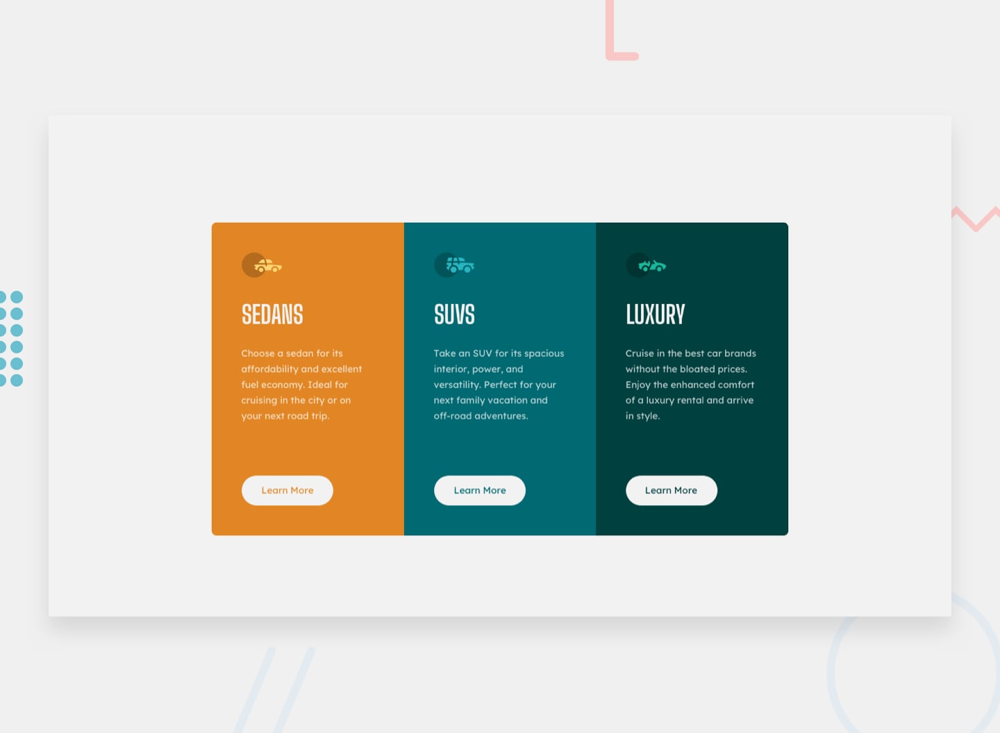

# Frontend Mentor - 3-column preview card component



## Table of contents

- [Overview](#overview)
  - [The challenge](#the-challenge)
  - [Links](#links)
- [My process](#my-process)
  - [Built with](#built-with)
  - [What I learned](#what-i-learned)
- [Author](#author)

## Overview

### The challenge

Your challenge is to build out this 3-column preview card component and get it looking as close to the design as possible.

You can use any tools you like to help you complete the challenge. So if you've got something you'd like to practice, feel free to give it a go.

Your users should be able to:

- View the optimal layout depending on their device's screen size
- See hover states for interactive elements

### Links

- Live Site URL: [github pages](https://GerardoCianciulli.github.io/3-column-preview-card-component/)

## My process

### Built with

- Semantic HTML5 markup
- CSS custom properties
- CSS Grid
- Flexbox
- Desktop-first workflow
- Media Queries
- [React](https://react.dev/)
- [Typescript](https://www.typescriptlang.org/)
- [Vite](https://vite.dev/)
- [gh-pages](https://github.com/tschaub/gh-pages)

### What I learned

I learned how to pass a value from a React prop straight into CSS with a custom property, and how to type it in Typescript. `CSSProperties` doesn't know about custom properties, so I extended it with the one the card needs. Each card gets its accent colour from a single `color` prop, and the CSS uses it for both the column background and the button text.

```tsx
type PreviewCardStyle = CSSProperties & { '--card-color': string }

function PreviewCard({ title, description, icon, color }: PreviewCardProps) {
  const style: PreviewCardStyle = { '--card-color': color }

  return (
    <article className="preview-card" style={style}>
      ...
    </article>
  )
}
```

```css
.preview-card {
  background-color: var(--card-color);
}

.preview-card__link {
  color: var(--card-color);
}
```

Exporting the props type from the component let me describe all three cards as a typed array and render them with `map`, so adding a new car category is just one more object.

```tsx
const cards: PreviewCardProps[] = [
  { title: 'Sedans', description: '...', icon: sedansIcon, color: 'var(--color-bright-orange)' },
  ...
]

{cards.map((card) => (
  <PreviewCard key={card.title} {...card} />
))}
```

For the hover state, the button gets a white outline and a transparent fill. To stop the button from growing when the border appears, it always has a 2px border in the same colour as its background, and only the colours change on hover and keyboard focus.

```css
.preview-card__link {
  border: 2px solid var(--color-very-light-gray);
  background-color: var(--color-very-light-gray);
}

.preview-card__link:hover,
.preview-card__link:focus-visible {
  border-color: var(--color-white);
  background-color: transparent;
  color: var(--color-white);
}
```

Building desktop first, the three columns are an equal-width grid and `margin-top: auto` pins each button to the bottom of its column. A single media query then stacks the columns for mobile.

```css
.card-group {
  display: grid;
  grid-template-columns: repeat(3, 1fr);
  width: min(100% - 3rem, 57.5rem);
}

@media (max-width: 56.25rem) {
  .card-group {
    grid-template-columns: 1fr;
    width: min(100% - 3rem, 20.4375rem);
  }
}
```

## Author

- Portfolio - [Gerardo Cianciulli](https://www.behance.net/gerardo-cianciulli)
- Frontend Mentor - [Gerardo Cianciulli](https://www.frontendmentor.io/profile/GerardoCianciulli)
- Linkedin - [Gerardo Cianciulli](https://www.linkedin.com/in/gerardo-cianciulli/)
